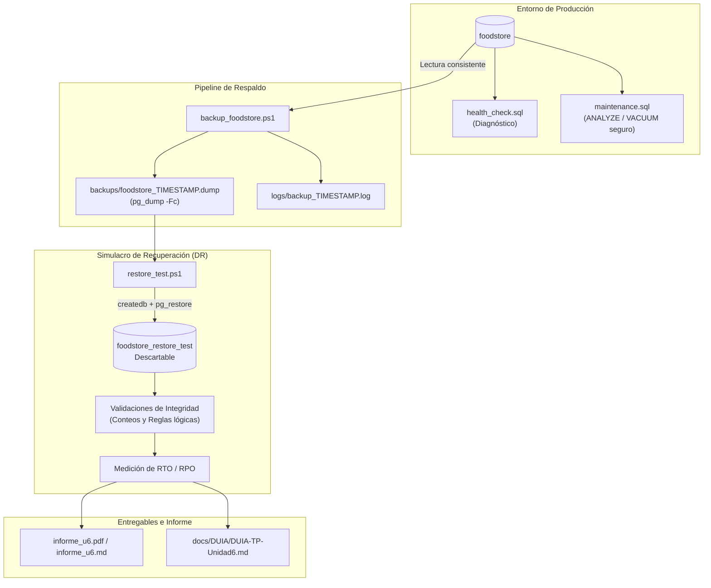

# Design Document — Unidad 6: Mantenimiento, Respaldo y Recuperación

## Architecture Overview

El diseño de la solución aborda la continuidad operativa de la base de datos `foodstore` (PostgreSQL 16+) implementando un ciclo virtuoso de **Respaldo Automatizado**, **Monitoreo Preventivo**, **Mantenimiento No Bloqueante** y **Recuperación con Validación Automática**.

---

## Design Decisions

### D1: Formato de Respaldo: Custom (`-Fc`) vs Plain SQL (`-Fp`)
- **Decisión:** Utilizar exclusivamente `pg_dump -Fc` (formato custom binario comprimido).
- **Justificación:**
  1. *Compresión nativa:* Reduce drásticamente el espacio en disco y el I/O en red.
  2. *Flexibilidad con `pg_restore`:* Permite reordenar la carga de datos y creación de índices, seleccionar objetos específicos (`-t`), y restaurar en paralelo (`-j`) si se requiere.
  3. *TOC (Table of Contents):* Permite inspeccionar los contenidos y metadatos con `pg_restore -l` sin necesidad de descomprimir o ejecutar el archivo.

### D2: Gestión Segura de Credenciales y Cero Exposición
- **Decisión:** Ningún script (`.ps1`, `.sql`, `.sh`) almacenará credenciales en texto plano.
- **Justificación:** Cumplimiento estricto de las directivas de seguridad de la cátedra y `AGENTS.md`.
- **Mecanismo:** El script espera que el operador configure la variable de entorno de sesión `$env:PGPASSWORD` en memoria volátil de PowerShell o utilice un archivo `pgpass.conf` con permisos restringidos. Los parámetros no sensibles (`DB_HOST`, `DB_PORT`, `DB_USER`, `DB_NAME`) se definen con valores por defecto pero parametrizables.

### D3: Captura de Errores y Logging en PowerShell
- **Decisión:** Capturar `$LASTEXITCODE` inmediatamente tras la invocación de `pg_dump` y redirigir toda salida (stdout y stderr) a un archivo de log fechado en `logs/`.
- **Gotcha / Riesgo de IA identificado:** En PowerShell, si se ejecuta un comando intermedio (como `Write-Host` o una asignación de variable con cmdlet) entre la llamada a la herramienta nativa y la lectura de `$LASTEXITCODE`, el código de salida de PostgreSQL puede perderse o ser enmascarado. El diseño establece capturar `$dumpExitCode = $LASTEXITCODE` en la línea inmediata siguiente.

### D4: Mantenimiento Seguro: Prohibición de `VACUUM FULL`
- **Decisión:** Prohibir terminantemente el uso periódico de `VACUUM FULL`. En su lugar, el script `sql/maintenance.sql` ejecuta un análisis previo de tuplas muertas y corre `ANALYZE` selectivo o `VACUUM` concurrente estándar.
- **Fundamento Técnico:**
  - `VACUUM FULL` adquiere un bloqueo exclusivo de acceso (`AccessExclusiveLock`) sobre toda la tabla, impidiendo no solo escrituras sino también **lecturas concurrentes** durante todo el tiempo que demore la reconstrucción de la tabla. En una tienda en línea como Food Store, esto provocaría una caída total del servicio (*downtime*).
  - Un `VACUUM` estándar adquiere un bloqueo `ShareUpdateExclusiveLock`, que permite operaciones normales de `SELECT`, `INSERT`, `UPDATE` y `DELETE` concurrentes mientras se recupera el espacio libre para ser reutilizado.

### D5: Metodología de Medición RTO y RPO en el Simulacro
- **RTO (Recovery Time Objective):**
  - *Previsto en diseño:* Menor a 5 minutos (300 segundos) para la recuperación de una base mediana.
  - *Medición:* Se utiliza `[System.Diagnostics.Stopwatch]::StartNew()` en `restore_test.ps1`, arrancando en $T_0$ (inmediatamente antes del `createdb`) y deteniéndose en $T_1$ tras la finalización exitosa de las 3 consultas de validación de consistencia.
  $$\text{RTO Observado} = T_1 - T_0$$
- **RPO (Recovery Point Objective):**
  - *Previsto en diseño:* Máximo 24 horas (política de respaldo diario programado a la medianoche).
  - *Medición:* Diferencia temporal entre la fecha de creación del dump utilizado y la fecha/hora en que se simula el incidente.
  $$\text{RPO Observado} = \text{FechaHora}(\text{Simulacro}) - \text{FechaHora}(\text{Dump})$$

### D6: Compatibilidad de Nombres: Tabla `usuario` y Alias `cliente`
- **Decisión:** La consulta de validación propuesta por la cátedra incluye `SELECT 'cliente', COUNT(*) FROM cliente`. En el esquema canónico de Food Store la tabla de clientes se denomina `usuario`.
- **Solución Arquitectónica:** En `foodstore` (y en el script de esquema base) aseguramos la existencia de la vista `CREATE OR REPLACE VIEW cliente AS SELECT * FROM usuario;`. De esta forma, las validaciones de la cátedra se ejecutan sin error y reflejan con 100% de precisión la cardinalidad de la entidad cliente.

---

## Technical Specifications of Artifacts

| Artefacto | Responsabilidad Técnica | Parámetros Clave |
| :--- | :--- | :--- |
| `SPEC_U6.md` | Especificación de 1 página del plan de mantenimiento y seguridad. | Matriz de 4 tareas mínimas, condiciones de corte y seguridad. |
| `backup_foodstore.ps1` | Script ejecutable en PowerShell de respaldo. | `-Host`, `-Port`, `-User`, `-Database`, formato `-Fc`, logging en `logs/`. |
| `sql/health_check.sql` | Script SQL de monitoreo de 4 dimensiones. | Tamaño BD, transacciones/conexiones, tuplas muertas/bloat, queries activas. |
| `sql/maintenance.sql` | Mantenimiento seguro justificado. | Diagnóstico de churn, `VACUUM` / `ANALYZE` estándar sin locks exclusivos. |
| `restore_test.ps1` | Automatización del simulacro de recuperación. | Detección de último dump, createdb, pg_restore, validaciones lógicas, cronómetro RTO/RPO. |
| `informe_u6.md` / `.pdf` | Informe post-incidente consolidado. | RTO/RPO observado vs previsto, incidentes, mejoras y verificación DUIA. |
